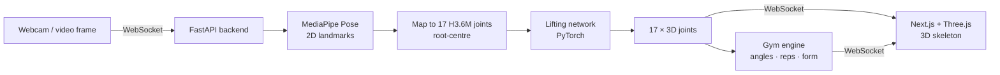

# PoseLift — Real-Time 3D Pose Estimation & Gym Form Feedback

PoseLift turns an ordinary webcam into a 3D motion tracker. It detects your body in each frame, **lifts the 2D keypoints into a 3D skeleton** with a deep-learning model trained on Human3.6M + MPI-INF-3DHP, and renders it live in the browser. A **gym mode** counts your reps and checks your form for bicep curls and squats in real time.

<!-- Add a screenshot or GIF here, e.g.  -->

## Features

- **Live webcam → 3D skeleton** — frames are streamed over WebSockets and the 3D pose is rendered with Three.js (drag to rotate, scroll to zoom, colour-coded body segments)
- **Gym mode** — rep counting, good vs. bad reps, and live form cues, e.g.
  - Bicep curl: *"Half rep — complete full range of motion"*, *"Curl higher — bring wrist to shoulder level"*
  - Squat: *"Go deeper — thighs parallel to floor"*, knees-caving-in detection
- **Video upload** — frame-by-frame inference with animated 3D playback
- **2D skeleton overlay** on the dashboard alongside the 3D view

## How it works



1. **2D detection** — MediaPipe Pose finds body landmarks; they're converted to the 17-joint Human3.6M skeleton and centred on the pelvis. Frames where the person isn't centred are skipped.
2. **2D → 3D lifting** — a residual MLP predicts the 3D position of every joint.
3. **Gym engine** — joint angles (elbow for curls, knee for squats) are averaged across both sides, smoothed over 6 frames, and run through a rep state machine with thresholds and stall detection for half reps.

## The model

`MultiViewLiftingMLP` (`backend/model.py`): **136 → 1024 → 4 residual blocks (1024, BatchNorm, ReLU, Dropout 0.5) → 51** (17 joints × 3D).

The network was trained on four views of each pose; at inference time the single webcam view is fed together with three slightly jittered copies of itself to match that input format.

**Training data** (`model-training/combined_h36m_mpi_pose_estimation.ipynb`):

| Dataset | Subjects | Samples |
|---|---|---|
| Human3.6M | S1, S5, S6, S7, S8, S9, S11 | ~1.96M |
| MPI-INF-3DHP | S1–S8 | ~131K |
| **Combined** | | **~2.09M** |

**Two-stage training**
- **Stage 1** — MSE loss, 80 epochs
- **Stage 2** — fine-tuning with **anatomical losses** (bone-length consistency + left/right symmetry), 30 epochs at lr 1e-4

### Results (held-out test split, 70,766 poses)

| Metric | Score |
|---|---|
| **MPJPE** (mean per-joint position error) | **35.83 mm** |
| PCK @ 50 mm | 79.06 % |
| PCK @ 100 mm | 95.37 % |
| PCK @ 150 mm | 98.82 % |

The other notebooks in `model-training/` are earlier experiments (MPI-INF-3DHP only, V2/V3 iterations).

## Tech stack

| Part | Tech |
|---|---|
| Backend | Python · FastAPI · WebSockets · PyTorch · MediaPipe · OpenCV |
| Frontend | Next.js 14 · TypeScript · Tailwind CSS · Three.js |
| Training | PyTorch · Jupyter |
| Deployment | Docker / Railway (backend) · Vercel (frontend) |

## Project structure

```
backend/
  main.py            FastAPI app — /health, /api/exercises, /api/upload-video, /ws/pose, /ws/gym
  inference.py       MediaPipe → 17 joints → model → 3D pose
  model.py           Lifting network
  gym_engine.py      Angles, rep counting and form checks
  best_combined_stage2.pth   Trained weights
frontend/
  app/               Pages: home, login, dashboard, gym
  components/Skeleton3D.tsx  Three.js skeleton
  lib/skeleton2d.ts  2D overlay helpers
model-training/      Training notebooks
```

## Run locally

**Backend** (Python 3.11)

```bash
cd backend
pip install -r requirements.txt
uvicorn main:app --reload --port 8000
```

Check it's running: http://localhost:8000/health

**Frontend**

```bash
cd frontend
npm install
cp .env.example .env.local
npm run dev
```

Open http://localhost:3000

## Deploy

**Backend → Railway:** create a project from this repo with `backend/` as the root (a `Dockerfile` and `Procfile` are included) and set `MODEL_PATH=best_combined_stage2.pth`.

**Frontend → Vercel:** import the repo with `frontend/` as the root and set:

```
NEXT_PUBLIC_BACKEND_URL=https://<your-backend>.up.railway.app
NEXT_PUBLIC_WS_URL=wss://<your-backend>.up.railway.app
```

> Login currently uses a simple localStorage session for demo purposes.

## License

[MIT](LICENSE)
